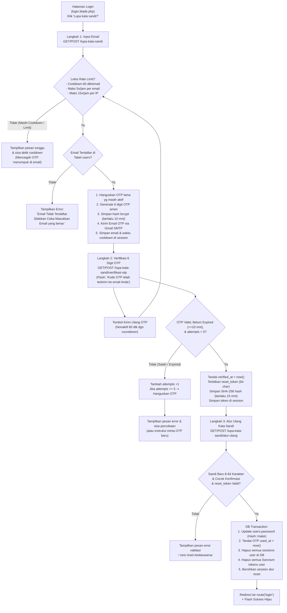

# Planning & Spesifikasi Teknis: Fitur Lupa Kata Sandi (Forget Password) dengan OTP Email (Version 1.0)

> [!IMPORTANT]
> **Versi Dokumen:** `version 1.0`  
> Dokumen ini disusun untuk **Tahap Planning, Spesifikasi Teknis, & Keputusan Terkunci** fitur Lupa Kata Sandi berbasis OTP Email untuk aplikasi **Prevanta - Posyandu Jambu 77** (~25 pengguna orang tua, sekaligus mendukung seluruh role aktif di tabel `users`).  
> Tidak ada file kode proyek yang diubah pada tahap penyusunan planning ini. Cakupan eksekusi **v1.0 difokuskan pada versi Website (Blade)** dengan arsitektur *Shared Service* agar integrasi **API Mobile (Flutter/Sanctum)** pada tahap lanjutan dapat langsung menggunakan logika inti yang sama.

---

## 1. Bedah Alur & Desain Antarmuka (UI Breakdown & Theme Mapping)

### 1.1. Alur End-to-End 3 Langkah (Website)



### 1.2. Rincian Komponen per Halaman (Selaras [login.blade.php](file:///d:/laragon/www/prevanta/resources/views/auth/login.blade.php))

Seluruh halaman pemulihan sandi mempertahankan tata letak 2 panel ([login.blade.php](file:///d:/laragon/www/prevanta/resources/views/auth/login.blade.php#L49-L84)): panel ilustrasi kiri (`#fdf0f3` dengan *wave divider* SVG) dan panel form kanan (gradien maroon `#9b2c45` → `#7a2137`).

1. **Pembaruan Halaman Login ([login.blade.php](file:///d:/laragon/www/prevanta/resources/views/auth/login.blade.php)):**
   - Tautan `Lupa  kata sandi?` pada baris 174–176 diubah menjadi `href="{{ route('password.request') }}"` dengan teks rapi `Lupa kata sandi?`.
   - Menambahkan kotak alert sukses `@if (session('success'))` berwarna hijau lembut di atas form (sejajar posisi `@if ($errors->any())`) agar pesan sukses setelah atur ulang kata sandi maupun registrasi tampil jelas kepada pengguna.
2. **Halaman Langkah 1 — Input Email (`resources/views/auth/forgot-password.blade.php`):**
   - **Header:** Tautan kembali ke `route('login')` (`Kembali ke Halaman Masuk`), badge indikator `Langkah 1 dari 3`, judul `Lupa Kata Sandi?`, dan subjudul `Masukkan email akun Anda untuk menerima kode verifikasi (OTP) 6 digit.`
   - **Alert Error / Cooldown:** Menampilkan pesan validasi seperti `"Email Tidak Terdaftar. Silahkan Coba Masukkan Email yang benar."` atau pesan sisa waktu tunggu jika masih dalam masa cooldown 60 detik.
   - **Input Email:** `type="email"`, `name="email"`, `maxlength="100"`, `autocomplete="email"`, `required`, lengkap dengan ikon amplop.
   - **Tombol Utama:** `Kirim Kode OTP` (menonaktifkan tombol sementara saat form sedang dikirim untuk mencegah klik ganda).
3. **Halaman Langkah 2 — Verifikasi 6 Digit OTP (`resources/views/auth/verify-otp.blade.php`):**
   - **Header:** Tautan `Ganti Email` (kembali ke `route('password.request')`), badge indikator `Langkah 2 dari 3`, judul `Verifikasi Kode OTP`.
   - **Banner Info Terkirim:** Kotak notifikasi sukses bahwa **kode OTP 6 digit telah terkirim** ke alamat email tersamarkan (contoh: `s***@gmail.com`) beserta pengingat cek folder *Spam/Promosi*.
   - **Input 6 Digit OTP:** 6 kotak input angka interaktif (disinkronkan ke hidden input `name="otp"`) dengan UX ramah ponsel:
     - `inputmode="numeric"`, `pattern="[0-9]*"`, `autocomplete="one-time-code"`.
     - Otomatis berpindah fokus ke kotak berikutnya saat mengetik dan mundur saat menekan *Backspace*.
     - Mendukung *paste* langsung 6 digit kode OTP dari email sekaligus.
   - **Tombol Utama:** `Verifikasi Kode OTP`.
   - **Kontrol Kirim Ulang dengan Cooldown 60 Detik:**
     - Form terpisah ke `route('password.otp.resend')` dengan tombol `Kirim Ulang Kode OTP`.
     - Menggunakan *countdown timer* berbasis timestamp sisa cooldown dari server (`cooldown_remaining_seconds`), sehingga **tombol tetap terkunci meski halaman di-refresh** sampai 60 detik habis. Ini mencegah kode OTP menumpuk di email user.
4. **Halaman Langkah 3 — Atur Ulang Kata Sandi (`resources/views/auth/reset-password.blade.php`):**
   - **Header:** Badge indikator `Langkah 3 dari 3`, judul `Buat Kata Sandi Baru`, subjudul `OTP berhasil diverifikasi. Silakan buat kata sandi baru untuk akun Anda.`
   - **Input 1 — Kata Sandi Baru (`password`):** `minlength="8"`, `maxlength="64"`, `autocomplete="new-password"`, lengkap dengan tombol ikon mata *show/hide* dan helper text selaras [Planning Profil Orang Tua version 1.1.md](file:///d:/laragon/www/prevanta/docs/Planning%20Profil%20Orang%20Tua%20version%201.1.md#L39): `8–64 karakter. Disarankan menggunakan kombinasi huruf dan angka.`
   - **Input 2 — Konfirmasi Kata Sandi Baru (`password_confirmation`):** `minlength="8"`, `maxlength="64"`, `autocomplete="new-password"`, lengkap dengan tombol ikon mata *show/hide*.
   - **Tombol Utama:** `Simpan Kata Sandi Baru`.
5. **Template Email OTP (`resources/views/emails/password-reset-otp.blade.php` + versi teks polos `password-reset-otp-text.blade.php`):**
   - **Branding:** `Prevanta - Posyandu Jambu 77`.
   - **Subject:** `Kode OTP Reset Kata Sandi - Prevanta Posyandu Jambu 77`.
   - **Konten Utama:** Sapaan nama user (`Halo, {{ $userName }}`), kotak kode OTP 6 digit berukuran besar (`32px`, tebal, `letter-spacing: 8px`) agar mudah dibaca di layar HP orang tua, keterangan masa berlaku **10 menit**, serta peringatan untuk tidak membagikan kode kepada siapa pun.

### 1.3. Pemetaan Variabel Warna & Tipografi (Mengikuti [login.blade.php](file:///d:/laragon/www/prevanta/resources/views/auth/login.blade.php#L12-L47))

| Token / Elemen | Kode Warna / Nilai | Penggunaan |
| :--- | :--- | :--- |
| Latar Panel Kiri | `#fdf0f3` / `#f7f0f2` | Panel ilustrasi keluarga Prevanta (`logoorangtua.png`) |
| Gradien Panel Kanan | `linear-gradient(to bottom right, #9b2c45, #8c2540, #7a2137)` | Latar utama kartu form 3 langkah |
| Input Field & Kotak OTP | `rgba(255,255,255,0.12)` + border `rgba(255,255,255,0.25)` | Input email, 6 kotak OTP, dan input kata sandi baru |
| Alert Sukses (OTP Terkirim / Reset Berhasil) | `rgba(16,185,129,0.18)` + border `rgba(110,231,183,0.45)` + teks `#d1fae5` | Banner konfirmasi pengiriman OTP & flash sukses di halaman login |
| Alert Error | `rgba(248,113,113,0.15)` + border `rgba(252,165,165,0.40)` + teks `#fecaca` | Banner error email tidak terdaftar, OTP salah, atau cooldown |
| Tipografi | `'Plus Jakarta Sans', ui-sans-serif, system-ui, sans-serif` | Konsisten 100% dengan [login.blade.php](file:///d:/laragon/www/prevanta/resources/views/auth/login.blade.php#L12) |

---

## 2. Arsitektur Database, Model, & Konfigurasi Email (Gmail SMTP)

### 2.1. Struktur Tabel Baru `password_reset_otps`

Belum ada tabel pemulihan kata sandi di `database/migrations`, sehingga dibuat satu tabel baru `password_reset_otps`:

| Kolom | Tipe & Constraint | Keterangan |
| :--- | :--- | :--- |
| `id` | `BIGINT UNSIGNED AUTO_INCREMENT PK` | Primary key. |
| `email` | `VARCHAR(100) NOT NULL` | Email target (disimpan lowercase), selaras dengan `users.email VARCHAR(100)`. |
| `otp_hash` | `VARCHAR(255) NOT NULL` | Hash `bcrypt` dari kode OTP 6 digit (tidak pernah disimpan plain-text). |
| `attempts` | `TINYINT UNSIGNED NOT NULL DEFAULT 0` | Penghitung percobaan salah verifikasi OTP. |
| `max_attempts` | `TINYINT UNSIGNED NOT NULL DEFAULT 5` | Batas maksimal salah input sebelum OTP hangus otomatis. |
| `expires_at` | `TIMESTAMP NOT NULL` | Masa berlaku kode OTP (`created_at + 10 menit`). |
| `verified_at` | `TIMESTAMP NULL` | Waktu kode OTP dinyatakan valid. |
| `reset_token_hash` | `CHAR(64) NULL` | Hash `SHA-256` dari `reset_token` acak 64 karakter pascaverifikasi OTP. |
| `reset_token_expires_at` | `TIMESTAMP NULL` | Masa berlaku `reset_token` (`verified_at + 15 menit`). |
| `used_at` | `TIMESTAMP NULL` | Penanda OTP & `reset_token` sudah selesai dipakai (*single-use*). |
| `invalidated_at` | `TIMESTAMP NULL` | Diisi jika OTP digantikan permintaan baru atau hangus karena salah 5x. |
| `request_ip` | `VARCHAR(45) NULL` | IP peminta untuk audit trail & pencegahan penyalahgunaan. |
| `created_at` | `TIMESTAMP NULL` | Waktu pembuatan OTP (juga acuan verifikasi cooldown 60 detik di DB). |
| `updated_at` | `TIMESTAMP NULL` | Waktu pembaruan terakhir. |

**Indeks & Pemeliharaan Data:**
- `INDEX idx_otp_email_active (email, used_at, invalidated_at, created_at)` — pencarian OTP aktif terbaru per email.
- `INDEX idx_otp_reset_token (reset_token_hash)` — validasi cepat tahap 3.
- `INDEX idx_otp_created_at (created_at)` — mendukung pembersihan otomatis via `Prunable` (hapus record >24 jam melalui jadwal harian di [routes/console.php](file:///d:/laragon/www/prevanta/routes/console.php)).

### 2.2. Konfigurasi Email Pengirim: Akun Google/Gmail Baru Khusus Sistem OTP

> [!NOTE]
> **Penjelasan Konsep "Akun Gmail Baru Khusus Sistem OTP":**  
> Benar sesuai pemahaman Anda — ini adalah **1 akun Gmail baru polosan** (misalnya `prevanta.jambu77@gmail.com` atau `noreply.prevanta@gmail.com`) yang dibuat khusus **hanya sebagai pengirim email sistem Prevanta** (bukan email pribadi developer/kader).  
> Keuntungannya: gratis (±500 email/hari dari Google, jauh di atas kebutuhan 25 user posyandu), tidak perlu beli domain, email pribadi tidak tercampur, dan mudah diserahterimakan ke pengurus Posyandu Jambu 77.

**Langkah Aktivasi Gmail SMTP (Menggunakan App Password, BUKAN Password Login Gmail):**
1. Buat 1 akun Google/Gmail baru khusus sistem Prevanta.
2. Masuk ke **Manage your Google Account → Security → 2-Step Verification**, lalu aktifkan **Verifikasi 2 Langkah**.
3. Cari menu **App Passwords** (Sandi Aplikasi), buat sandi baru dengan nama `Prevanta OTP`, lalu salin **16 karakter sandi aplikasi** yang diberikan Google.
4. Masukkan ke file `.env` proyek (tidak boleh di-commit ke Git):
   ```env
   MAIL_MAILER=smtp
   MAIL_SCHEME=null
   MAIL_HOST=smtp.gmail.com
   MAIL_PORT=587
   MAIL_USERNAME="email-sistem-baru@gmail.com"
   MAIL_PASSWORD="16-karakter-app-password-tanpa-spasi"
   MAIL_FROM_ADDRESS="email-sistem-baru@gmail.com"
   MAIL_FROM_NAME="Prevanta - Posyandu Jambu 77"
   ```
   *(Alternatif jika port `587` terblokir firewall lokal: gunakan `MAIL_PORT=465` dengan `MAIL_SCHEME=smtps`.)*
5. **Mode Pengiriman:** Mengirim email secara **sinkron** (`Mail::to($user->email)->send(...)`) agar OTP masuk ke inbox user dalam 1–3 detik tanpa ketergantungan background queue worker (`php artisan queue:work`). Pengujian otomatis PHPUnit tetap memakai `Mail::fake()` sehingga tidak pernah mengirim email sungguhan saat `php artisan test`.

---

## 3. Spesifikasi Fitur, Aturan Validasi, Rate Limit, & Keamanan

### 3.1. Aturan Validasi (`FormRequest`)

Seluruh validasi dipisahkan dalam 3 FormRequest di folder `app/Http/Requests/Auth/` agar rapi dan dapat digunakan ulang oleh Web maupun API Mobile kelak:

| FormRequest | Field | Normalisasi (`prepareForValidation`) | Aturan Validasi (`rules()`) | Pesan Error Bahasa Indonesia |
| :--- | :--- | :--- | :--- | :--- |
| `RequestPasswordOtpRequest` | `email` | `strtolower(trim($email))` | `['bail', 'required', 'string', 'email', 'max:100']` | Email wajib diisi; format email tidak valid; maksimal 100 karakter. |
| `VerifyPasswordOtpRequest` | `otp` | `preg_replace('/\D+/', '', trim($otp))` | `['bail', 'required', 'digits:6']` | Kode OTP wajib diisi; kode OTP harus berupa 6 digit angka. |
| `ResetPasswordWithOtpRequest` | `password` | **TIDAK di-`trim`** | `['bail', 'required', 'string', 'min:8', 'max:64', 'confirmed']` | Kata sandi baru wajib diisi; minimal 8 karakter; maksimal 64 karakter; konfirmasi kata sandi tidak cocok. |
| | `password_confirmation` | **TIDAK di-`trim`** | `['bail', 'required', 'string', 'min:8', 'max:64']` | Konfirmasi kata sandi wajib diisi; minimal 8 karakter; maksimal 64 karakter. |

### 3.2. Matriks Skenario Perilaku Sistem (Terkunci)

| Tahap | Kondisi Input / Sistem | Hasil yang Diharapkan |
| :--- | :--- | :--- |
| **Tahap 1 (Request OTP)** | Email tidak ditemukan di tabel `users` | Kembali ke form dengan error pada field `email`: **`"Email Tidak Terdaftar. Silahkan Coba Masukkan Email yang benar."`** Tidak ada email dikirim & tidak membuat record OTP. |
| **Tahap 1 / Kirim Ulang** | Email terdaftar, tetapi baru meminta OTP **< 60 detik** lalu | **Ditolak oleh cooldown 60 detik** (dicek di RateLimiter & timestamp `created_at` OTP terakhir di DB). Menampilkan sisa waktu tunggu: *"Mohon tunggu X detik sebelum meminta kode OTP baru."* Tidak mengirim email baru sehingga **OTP tidak menumpuk di inbox user**. |
| **Tahap 1 (Request OTP)** | Email terdaftar (`orang_tua`, `kader`, atau `bidan`) & lolos cooldown/rate limit | Hanguskan OTP aktif sebelumnya, buat OTP 6 digit baru (berlaku 10 menit), kirim email via Gmail SMTP, redirect ke halaman verifikasi OTP dengan pesan sukses: **`"Kode OTP 6 digit telah terkirim ke email Anda. Silakan periksa kotak masuk atau folder spam."`** |
| **Tahap 1 (Request OTP)** | Melebihi 5x/jam per email atau 15x/jam per IP | Ditolak dengan pesan ramah untuk mencoba lagi nanti (melindungi akun Gmail SMTP dan mencegah *enumeration* massal per IP). |
| **Tahap 2 (Verify OTP)** | Salah ketik OTP (percobaan ke-1 s.d. ke-4) | `attempts` bertambah +1; tampil error: *"Kode OTP tidak sesuai. Sisa percobaan: X kali."* |
| **Tahap 2 (Verify OTP)** | Salah ketik OTP ke-5 kalinya | `attempts = 5` & `invalidated_at = now()`; OTP hangus permanen; tampil error: *"Batas percobaan kode OTP telah habis. Silakan minta kode OTP baru."* |
| **Tahap 2 (Verify OTP)** | OTP melewati 10 menit (`expires_at < now()`) | Ditolak: *"Kode OTP telah kedaluwarsa. Silakan kirim ulang kode OTP baru."* |
| **Tahap 2 (Verify OTP)** | OTP benar & masih aktif | Set `verified_at = now()`, buat `reset_token` 64 karakter (simpan SHA-256 hash berlaku 15 menit), simpan `reset_token` di session, redirect ke halaman *Atur Ulang Kata Sandi*. |
| **Tahap 3 (Reset Sandi)** | `reset_token` hilang, tidak cocok, sudah dipakai, atau >15 menit | Redirect kembali ke halaman input email dengan error: *"Sesi atur ulang kata sandi tidak valid atau telah kedaluwarsa. Silakan ulangi permintaan OTP."* |
| **Tahap 3 (Reset Sandi)** | Sandi baru valid (`8–64` karakter) & konfirmasi cocok | Dalam `DB::transaction`: update `users.password`, set `used_at = now()`, hapus `reset_token_hash`, hapus seluruh sesi user di tabel `sessions`, hapus seluruh Sanctum tokens user, bersihkan session reset, lalu redirect ke `route('login')` dengan flash sukses hijau. |

### 3.3. Rate Limiting Berlapis ([AppServiceProvider.php](file:///d:/laragon/www/prevanta/app/Providers/AppServiceProvider.php))

Menggunakan `CACHE_STORE=database` (sudah aktif di proyek) untuk mencegah kebocoran kuota Gmail SMTP sekaligus memitigasi risiko *email enumeration*:

| Nama Rate Limiter | Aturan Batasan | Key | Fungsi Utama |
| :--- | :--- | :--- | :--- |
| `password-otp-request` | **Maks 15 req / 1 jam per IP** + **Maks 5 req / 1 jam per email** | `ip` & `email` | Mencegah scanning daftar email massal & melindungi kuota harian Gmail SMTP (~500/hari). |
| Cooldown Generate OTP (di `PasswordResetOtpService`) | **1 OTP per 60 detik per email** (berbasis `created_at` OTP terakhir di DB + cache) | `email` | Mencegah OTP menumpuk di kotak masuk email user (bekerja konsisten baik saat klik tombol *Kirim Ulang* maupun submit ulang di halaman 1). |
| `password-otp-verify` | **Maks 10 req / 15 menit** | `email` + `ip` | Lapisan proteksi brute-force di luar batas `max_attempts = 5` di database. |
| `password-otp-reset` | **Maks 5 req / 15 menit** | `email` + `ip` | Mencegah pengiriman berulang pada tahap simpan sandi baru. |

### 3.4. Desain Shared Service untuk Kesiapan API Mobile (Fase Berikutnya)

`App\Services\PasswordResetOtpService` dirancang tanpa ketergantungan pada objek `Session` atau `RedirectResponse` Web:
- `requestOtp(string $email, ?string $ipAddress = null): array` → memeriksa user, cooldown 60 detik, invalidasi OTP lama, generate & simpan hash OTP, kirim `PasswordResetOtpMail`, mengembalikan status & `cooldown_remaining_seconds`.
- `verifyOtp(string $email, string $otp): array` → memvalidasi OTP, mengelola `attempts` & `invalidated_at`, menerbitkan & mengembalikan `reset_token`.
- `resetPassword(string $email, string $resetToken, string $newPassword): void` → memvalidasi `reset_token` via `hash_equals()`, memperbarui `users.password`, menandai `used_at`, dan menghapus semua `sessions` + Sanctum tokens user dalam `DB::transaction()`.
- `getRemainingCooldownSeconds(string $email): int` → membantu UI Web (dan nantinya Flutter) menampilkan timer hitung mundur 60 detik yang akurat.

Dengan struktur ini, saat pengembangan **versi Mobile (API Flutter/Sanctum)** menyusul, cukup menambahkan `App\Http\Controllers\Api\PasswordResetOtpController` dan 3 endpoint di [routes/api.php](file:///d:/laragon/www/prevanta/routes/api.php) tanpa mengubah logika bisnis maupun tabel database.

---

## 4. Daftar File yang Akan Dibuat & Diubah (Cakupan v1.0: Website)

| No | Path File | Status | Deskripsi Perubahan |
| :--- | :--- | :--- | :--- |
| 1 | `database/migrations/xxxx_create_password_reset_otps_table.php` | **Baru** | Migrasi tabel `password_reset_otps` lengkap dengan kolom hash OTP, `attempts`, `reset_token_hash`, timestamp cooldown/expired/used/invalidated, dan indeks. |
| 2 | `app/Models/PasswordResetOtp.php` | **Baru** | Model Eloquent dengan casting timestamp, helper status (`isExpired`, `isUsable`, `isResetTokenValid`), dan `Prunable` (>24 jam). |
| 3 | `app/Mail/PasswordResetOtpMail.php` | **Baru** | Mailable OTP HTML + plain-text dengan subject `Kode OTP Reset Kata Sandi - Prevanta Posyandu Jambu 77`. |
| 4 | `resources/views/emails/password-reset-otp.blade.php` | **Baru** | Template email HTML responsif dengan kode 6 digit besar & mudah dibaca orang tua di HP. |
| 5 | `resources/views/emails/password-reset-otp-text.blade.php` | **Baru** | Template email teks polos pendamping untuk meningkatkan *deliverability* Gmail. |
| 6 | `app/Services/PasswordResetOtpService.php` | **Baru** | *Shared Service* terpusat (siap dipakai Web di v1.0 dan API Mobile pada fase lanjutan). |
| 7 | `app/Http/Requests/Auth/RequestPasswordOtpRequest.php` | **Baru** | FormRequest normalisasi & validasi email tahap 1. |
| 8 | `app/Http/Requests/Auth/VerifyPasswordOtpRequest.php` | **Baru** | FormRequest normalisasi & validasi 6 digit OTP tahap 2. |
| 9 | `app/Http/Requests/Auth/ResetPasswordWithOtpRequest.php` | **Baru** | FormRequest validasi kata sandi baru `8–64` karakter + konfirmasi tahap 3. |
| 10 | `app/Http/Controllers/PasswordResetOtpController.php` | **Baru** | Controller Web untuk 3 halaman + aksi kirim ulang OTP, pengelolaan session alur reset, dan masking email. |
| 11 | [app/Providers/AppServiceProvider.php](file:///d:/laragon/www/prevanta/app/Providers/AppServiceProvider.php) | **Edit** | Mendaftarkan `RateLimiter` (`password-otp-request`, `password-otp-verify`, `password-otp-reset`). |
| 12 | [routes/web.php](file:///d:/laragon/www/prevanta/routes/web.php) | **Edit** | Menambahkan 7 route Web lupa kata sandi di dalam grup middleware `guest`. |
| 13 | [routes/console.php](file:///d:/laragon/www/prevanta/routes/console.php) | **Edit** | Menjadwalkan `model:prune` harian untuk membersihkan record OTP lama (>24 jam). |
| 14 | [resources/views/auth/login.blade.php](file:///d:/laragon/www/prevanta/resources/views/auth/login.blade.php) | **Edit** | Menghubungkan tautan `Lupa kata sandi?` ke `route('password.request')` dan menambahkan kotak alert `@if (session('success'))`. |
| 15 | `resources/views/auth/forgot-password.blade.php` | **Baru** | View Blade Langkah 1 (Input Email) selaras desain [login.blade.php](file:///d:/laragon/www/prevanta/resources/views/auth/login.blade.php). |
| 16 | `resources/views/auth/verify-otp.blade.php` | **Baru** | View Blade Langkah 2 (6 kotak input OTP interaktif, banner OTP terkirim, tombol kirim ulang dengan countdown 60 detik). |
| 17 | `resources/views/auth/reset-password.blade.php` | **Baru** | View Blade Langkah 3 (Input kata sandi baru 8–64 karakter + konfirmasi + toggle ikon mata). |
| 18 | `tests/Feature/Auth/PasswordResetOtpWebTest.php` | **Baru** | Feature Test PHPUnit komprehensif untuk seluruh skenario Web, keamanan, cooldown 60 detik, rate limit, dan pesan error. |

> [!TIP]
> **Roadmap Fase Lanjutan (API Mobile — Setelah v1.0 Selesai di Website):**  
> Karena `PasswordResetOtpService` dan tabel `password_reset_otps` sudah siap sejak v1.0, fase integrasi Mobile nanti hanya memerlukan:
> 1. `app/Http/Controllers/Api/PasswordResetOtpController.php` (3 method: `requestOtp`, `verifyOtp`, `resetPassword`).
> 2. Penambahan 3 route publik di [routes/api.php](file:///d:/laragon/www/prevanta/routes/api.php) (`/api/forgot-password/request-otp`, `/verify-otp`, `/reset-password`).
> 3. Feature test `tests/Feature/Api/PasswordResetOtpApiTest.php`.

---

## 5. Task Board (Urutan Pengerjaan Step-by-Step)

### Fase 1: Database Migration, Model, & Mail
- [ ] **Step 1.1:** Membuat migrasi `create_password_reset_otps_table` dan menjalankan `php artisan migrate`.
- [ ] **Step 1.2:** Membuat model `App\Models\PasswordResetOtp` (`Prunable` >24 jam + helper status).
- [ ] **Step 1.3:** Membuat `App\Mail\PasswordResetOtpMail` beserta view `resources/views/emails/password-reset-otp.blade.php` dan `password-reset-otp-text.blade.php`.

### Fase 2: Shared Service, FormRequest, & Rate Limiter
- [ ] **Step 2.1:** Mendaftarkan 3 `RateLimiter` pada [app/Providers/AppServiceProvider.php](file:///d:/laragon/www/prevanta/app/Providers/AppServiceProvider.php) dan jadwal pruning harian pada [routes/console.php](file:///d:/laragon/www/prevanta/routes/console.php).
- [ ] **Step 2.2:** Membuat `App\Services\PasswordResetOtpService` (generate 6 digit aman, hash `bcrypt`, cooldown 60 detik, batas salah 5x, penerbitan `reset_token` SHA-256, update sandi + hapus semua `sessions` & Sanctum tokens dalam `DB::transaction`).
- [ ] **Step 2.3:** Membuat 3 FormRequest: `RequestPasswordOtpRequest`, `VerifyPasswordOtpRequest`, dan `ResetPasswordWithOtpRequest`.

### Fase 3: Controller Web, Routing, & Halaman Blade (3 Langkah)
- [ ] **Step 3.1:** Membuat `App\Http\Controllers\PasswordResetOtpController` dan mendaftarkan 7 rute `guest` di [routes/web.php](file:///d:/laragon/www/prevanta/routes/web.php).
- [ ] **Step 3.2:** Memperbarui [resources/views/auth/login.blade.php](file:///d:/laragon/www/prevanta/resources/views/auth/login.blade.php) (menghubungkan tautan `Lupa kata sandi?` & menambahkan banner `session('success')`).
- [ ] **Step 3.3:** Membuat 3 halaman Blade selaras tema login: `forgot-password.blade.php`, `verify-otp.blade.php` (6 kotak digit + timer cooldown 60 detik), dan `reset-password.blade.php`.

### Fase 4: Pengujian Otomatis, Formatting, & Uji Kirim Gmail SMTP
- [ ] **Step 4.1:** Membuat dan menjalankan Feature Test PHPUnit (`tests/Feature/Auth/PasswordResetOtpWebTest.php`):
  ```bash
  php artisan test --compact tests/Feature/Auth/PasswordResetOtpWebTest.php
  ```
- [ ] **Step 4.2:** Menjalankan Laravel Pint (`vendor/bin/pint --dirty --format agent`).
- [ ] **Step 4.3:** Uji kirim manual 1 email OTP menggunakan akun Gmail baru + App Password di `.env` lokal untuk memastikan email masuk ke kotak masuk utama (*Primary Inbox*) dengan tampilan rapi di HP.

---

## 6. Keputusan Klarifikasi (Terkunci / Disetujui)

Seluruh keputusan berikut merupakan hasil klarifikasi resmi sebelum implementasi dimulai:

1. **Pengirim Email OTP (Terkunci: Akun Google/Gmail Baru Khusus Sistem OTP via Gmail SMTP + App Password):**
   Menggunakan 1 akun Gmail baru polosan yang didedikasikan khusus untuk mengirim OTP sistem Prevanta (bukan email pribadi), terhubung melalui Gmail SMTP + App Password 16 karakter dengan kuota gratis ~500 email/hari dan pengiriman sinkron agar langsung diterima dalam hitungan detik.
2. **Cakupan Platform (Terkunci: Website Dulu di v1.0, Mobile Menyusul):**
   Implementasi v1.0 difokuskan penuh pada versi **Website (Blade)** sampai selesai dan teruji. Namun logika inti dipisahkan ke `PasswordResetOtpService` agar integrasi **API Mobile (Flutter/Sanctum)** pada tahap berikutnya tinggal menyambungkan controller & route API.
3. **Cakupan Role Pengguna (Terkunci: Semua Role Aktif):**
   Fitur dapat digunakan oleh seluruh akun yang terdaftar di tabel `users` (`orang_tua`, `kader`, dan `bidan`).
4. **Respons Email Tidak Terdaftar, Konfirmasi Terkirim, & Cooldown Anti-Menumpuk (Terkunci):**
   - Jika email tidak terdaftar: tampilkan error eksplisit **`"Email Tidak Terdaftar. Silahkan Coba Masukkan Email yang benar."`**
   - Jika email terdaftar: kirim OTP dan tampilkan pesan konfirmasi bahwa kode OTP telah terkirim ke email pengguna.
   - Terapkan **cooldown 60 detik** (di tombol kirim ulang maupun saat submit ulang email yang sama) agar kode OTP tidak menumpuk di kotak masuk email pengguna, ditambah rate limit ketat per IP untuk mencegah penyalahgunaan.
5. **Alur UI Halaman Web (Terkunci: 3 Langkah Terpisah):**
   Menggunakan 3 halaman terpisah (**Input Email → Verifikasi 6 Digit OTP → Buat Kata Sandi Baru**) yang selaras 100% dengan gaya visual [login.blade.php](file:///d:/laragon/www/prevanta/resources/views/auth/login.blade.php).
6. **Kebijakan Masa Berlaku OTP & Rate Limit (Terkunci):**
   Kode OTP 6 digit berlaku **10 menit**, maksimal **5x salah input** (hangus pada kesalahan ke-5), cooldown kirim ulang **60 detik**, batas **5x permintaan per jam per email**, dan batas **15x per jam per IP**. Aturan kata sandi baru tetap konsisten dengan v1.1 Profil Orang Tua (**8–64 karakter** + konfirmasi).
7. **Branding Posyandu (Terkunci):**
   Menggunakan nama **`Prevanta - Posyandu Jambu 77`** pada seluruh halaman lupa kata sandi serta subject dan isi template email OTP (konsisten dengan [login.blade.php](file:///d:/laragon/www/prevanta/resources/views/auth/login.blade.php#L6)).
