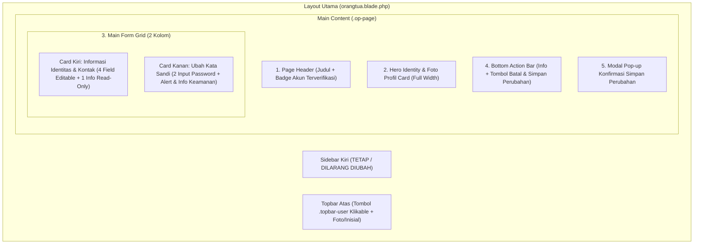

# Planning & Spesifikasi Teknis: Fitur Halaman Profil Orang Tua (Version 1.0)

> [!IMPORTANT]
> **Versi Dokumen:** `version 1.0`  
> Dokumen ini disusun untuk **Tahap 2, 3, & 4 (Planning, Spesifikasi Teknis, & Keputusan Terkunci)**. Tidak ada file kode proyek yang diubah pada tahap penyusunan planning ini. Seluruh rincian di bawah ini menjadi acuan resmi untuk pembuatan panduan kode *copy-paste* bertahap di **Tahap 5**.

---

## 1. Bedah Gambar Desain (UI Breakdown & Theme Mapping)

### 1.1. Rincian Komponen per Area Layar

1. **Sidebar (`<aside class="sidebar">` pada [orangtua.blade.php](file:///d:/laragon/www/prevanta/resources/views/orangtua/layouts/orangtua.blade.php#L36-L89)):**
   - **Pengecualian Wajib:** Tetap 100% menggunakan kondisi sidebar saat ini (menu *Anakku*, *Riwayat Pengukuran*, *Edukasi*, dan tombol *Keluar Akun* di bawah). Tidak ada perubahan struktur maupun CSS pada sidebar.
2. **Topbar (`<header class="topbar">` pada [orangtua.blade.php](file:///d:/laragon/www/prevanta/resources/views/orangtua/layouts/orangtua.blade.php#L96-L131)):**
   - Elemen `
` diubah menjadi tautan `<a href="{{ route('orangtua.profil.edit') }}" class="topbar-user {{ request()->routeIs('orangtua.profil*') ? 'is-active' : '' }}">`.
   - Saat halaman profil aktif, `.topbar-user.is-active` menampilkan kapsul (*pill*) dengan latar pink lembut (`#FCEEF2`) dan border tipis (`#F4D3DE`) seperti pada pojok kanan atas gambar desain.
   - Bagian `.user-avatar` menampilkan `` foto profil orang tua jika sudah diunggah, atau kembali ke inisial huruf pertama `{{ strtoupper(substr(Auth::user()->nama, 0, 1)) }}` jika belum ada foto.
3. **Section 1 — Page Header (`.op-header`):**
   - **Sisi Kiri:** Judul utama `Profil & Pengaturan Akun` dan subjudul `Kelola identitas akun, informasi kontak, foto profil orang tua, dan keamanan kata sandi Anda.`
   - **Sisi Kanan:** Badge kapsul hijau `Akun Orang Tua Terverifikasi` dengan ikon centang perisai (`fa-solid fa-shield-halved` / `fa-solid fa-circle-check`).
4. **Section 2 — Hero Identity & Foto Profil Card (`.op-hero-card`):**
   - Kartu penuh (*full-width*) dengan latar gradasi pink hangat (`linear-gradient(100deg, #FFFFFF 0%, #FDF2F5 55%, #F9DCE4 100%)`).
   - **Sisi Kiri (Avatar & Identitas Read-Only):**
     - Lingkaran foto profil berukuran `92px × 92px` dengan border putih `3px` dan bayangan halus (mendukung *live preview* saat memilih file foto baru).
     - Nama lengkap orang tua + ikon centang hijau, diikuti teks `NIK: ...`.
     - 3 *badge/pill* informasi *Read-Only*:
       1. Hubungan dengan balita (`Orang Tua / Wali` — warna wine/pink).
       2. Jenis kelamin (`Perempuan` atau `Laki-laki` — warna netral).
       3. Lokasi Posyandu (`Posyandu Mawar Melati • RW 03` — warna hijau lokasi, sesuai gambar desain).
   - **Sisi Kanan (Kontrol Foto Profil):**
     - Tombol putih `Ubah Foto Profil` (`<label for="foto_profil">` dengan ikon `fa-solid fa-cloud-arrow-up`).
     - Tombol `Hapus Foto` di sebelah kanan tombol ubah foto (mereset preview avatar ke inisial nama dan mengisi input tersembunyi `hapus_foto = 1`; penghapusan fisik di storage/DB dieksekusi saat form disimpan).
     - Teks bantuan: `Foto profil orang tua (bukan foto balita). Format JPG, PNG, atau WEBP, maksimal ukuran berkas 2 MB.`
5. **Section 3A — Card Kiri: Informasi Identitas & Kontak Orang Tua (`.op-card`):**
   - **Banner Header Card:** Kotak ikon `fa-regular fa-id-card` + judul `Informasi Identitas & Kontak Orang Tua` + deskripsi singkat.
   - **Input 1 — Nama Lengkap Orang Tua \*:** Input teks dengan ikon `fa-regular fa-user` dan teks bantuan `Sesuai KTP / Kartu Keluarga resmi.`
   - **Input 2 — NIK (Nomor Induk Kependudukan) \*:** Dilengkapi badge penghitung digit di kanan atas label (`16/16 Digit`), input numerik 16 digit dengan ikon `fa-solid fa-fingerprint`, dan teks bantuan `16 digit angka resmi kependudukan Indonesia.`
   - **Baris 2 Kolom (Email \* & No. HP / WhatsApp \*):**
     - **Input 3 — Email \*:** Input email dengan ikon `fa-regular fa-envelope` dan teks bantuan `Untuk notifikasi hasil KMS & buletin.`
     - **Input 4 — No. HP / WhatsApp \*:** Input numerik 8–13 digit dengan ikon `fa-solid fa-phone` dan teks bantuan `8–13 digit aktif untuk pesan Posyandu.`
   - **Kotak Info Domisili Posyandu (Read-Only):** Kotak berlatar krem dengan ikon pin lokasi hijau bertuliskan: `Terkait domisili Posyandu aktif: Posyandu Mawar Melati. Apabila pindah domisili atau pos pelayanan, hubungi kader Posyandu terkait.`
6. **Section 3B — Card Kanan: Ubah Kata Sandi (`.op-card`):**
   - **Banner Header Card:** Kotak ikon `fa-solid fa-clock-rotate-left` + judul `Ubah Kata Sandi` + subjudul `Opsional — isi hanya jika ingin memperbarui kunci akses akun Anda.`
   - **Kotak Info Amber:** Pesan informasi `Biarkan kolom kata sandi kosong jika Anda tidak ingin mengubah kata sandi saat ini.`
   - **Input 5A — Kata Sandi Baru:** Input password dengan ikon gembok `fa-solid fa-lock`, placeholder `Minimal 8 karakter`, tombol *toggle show/hide password* (`fa-regular fa-eye`), dan teks bantuan `Gunakan kombinasi huruf, angka, dan simbol.`
   - **Input 5B — Konfirmasi Kata Sandi Baru:** Input konfirmasi password dengan ikon perisai, placeholder `Ulangi kata sandi baru`, tombol *toggle show/hide password*, dan teks bantuan `Pastikan sama dengan kata sandi baru.`
   - **Footer Keamanan Card:** Ikon perisai hijau + teks `Terenkripsi standar keamanan data Kementerian Kesehatan RI.`
7. **Section 4 — Bottom Action Bar (`.op-action-bar`):**
   - Kartu horizontal di bagian bawah berisi teks informasi di kiri (`Hanya data profil & kontak orang tua di atas yang dapat diperbarui secara mandiri.`) serta dua tombol di kanan:
     - **Batal (`type="button"`):** Me-*reset* seluruh perubahan pada form kembali ke data awal (termasuk mengembalikan preview foto profil ke kondisi awal, mengembalikan `hapus_foto = 0`, dan menghitung ulang digit NIK).
     - **Simpan Perubahan (`type="button"`):** Membuka pop-up modal klarifikasi sebelum form dikirim.
8. **Section 5 — Pop-up Modal Klarifikasi Simpan Perubahan (`.op-modal-backdrop`):**
   - Muncul ketika tombol **Simpan Perubahan** ditekan.
   - Menampilkan ikon konfirmasi, judul **Simpan Perubahan Profil?**, pesan klarifikasi apakah user yakin ingin menyimpan perubahan, serta tombol **Periksa Kembali** (tutup modal) dan **Ya, Simpan Perubahan** (submit form).

---

### 1.2. Pemetaan Komponen Editable vs Read-Only

| No | Komponen pada Desain | Status | Sumber Data / Target Kolom DB | Keterangan |
| :--- | :--- | :--- | :--- | :--- |
| 1 | **Nama Lengkap Orang Tua** | **Editable (1/6)** | `users.nama` | Input teks wajib diisi |
| 2 | **NIK (Nomor Induk Kependudukan)** | **Editable (2/6)** | `orang_tua.nik` | Input 16 digit angka wajib diisi |
| 3 | **Email** | **Editable (3/6)** | `users.email` | Input email aktif wajib diisi |
| 4 | **No. HP / WhatsApp** | **Editable (4/6)** | `users.no_hp` | Input 8–13 digit angka wajib diisi |
| 5 | **Foto Profil Orang Tua** (Ubah & Hapus) | **Editable (5/6)** | `orang_tua.foto_profil` *(baru)* | Unggah JPG/PNG/WEBP maks 2 MB / hapus foto |
| 6 | **Kata Sandi Baru & Konfirmasi** | **Editable (6/6)** | `users.password` | Opsional (hanya di-update jika diisi) |
| 7 | Badge Status Akun (`Akun Orang Tua Terverifikasi`) | **Read-Only** | Statis / Role `orang_tua` | Hanya tampilan indikator status akun |
| 8 | Teks Nama & NIK pada Hero Card | **Read-Only** | `users.nama` & `orang_tua.nik` | Otomatis mengikuti data tersimpan di DB |
| 9 | Pill Hubungan (`Orang Tua / Wali`) | **Read-Only** | `orang_tua.hubungan_dengan_balita` | Tidak ada input di form update |
| 10 | Pill Jenis Kelamin (`Perempuan` / `Laki-laki`) | **Read-Only** | `orang_tua.jenis_kelamin` | `P` = Perempuan, `L` = Laki-laki |
| 11 | Pill & Info Domisili Posyandu | **Read-Only** | Statis / Posyandu aktif | Hanya tampil sebagai informasi |

---

### 1.3. Pemetaan Variabel Warna (Color Palette), Tipografi, & Namespace CSS

Untuk mencegah bentrok (*collision*) dengan [layout.css](file:///d:/laragon/www/prevanta/resources/css/kader/layout.css) maupun [anakku.css](file:///d:/laragon/www/prevanta/resources/css/orangtua/anakku.css), seluruh selector di file CSS baru (`resources/css/orangtua/profil.css`) akan di-*scope* di dalam container `.op-page` dengan prefix `.op-` (*Orangtua Profil*).

| Variabel / Token | Kode Warna / Nilai | Penggunaan pada Desain Profil |
| :--- | :--- | :--- |
| `--bg` | `#FBF9F6` | Latar belakang utama halaman & latar field input (`#F8F5F0`) |
| `--card` | `#FFFFFF` | Latar belakang kartu utama (Identitas, Kata Sandi, Action Bar) |
| `--ink` | `#2A2420` | Warna teks judul, label input, dan nilai input utama |
| `--ink-soft` / `--ink-faint` | `#6B6259` / `#9C9289` | Subjudul, helper text di bawah input, ikon dalam input |
| `--primary` / `--wine` | `#7C2740` / `#A23B55` | Gradasi tombol *Simpan Perubahan*, ikon kartu, aksen *required* `*` |
| `--primary-light` | `#FCEEF2` | Latar kotak ikon header kartu, pill *Orang Tua / Wali*, & active state topbar |
| `--line` | `#ECE3D8` | Garis tepi (*border*) kartu dan pembatas |
| `--green` / `--green-tint` | `#2FA36B` / `#E8F6EE` | Badge *Akun Orang Tua Terverifikasi*, pill *Posyandu*, pill *16/16 Digit* |
| `--amber` / `--amber-tint` | `#8A5A10` / `#FDF6EA` | Kotak peringatan opsional pada kartu *Ubah Kata Sandi* |
| Font Family | `'Inter', sans-serif` | Mengikuti font global dari [orangtua.blade.php](file:///d:/laragon/www/prevanta/resources/views/orangtua/layouts/orangtua.blade.php#L15) |

---

## 2. Arsitektur Database & Model

### 2.1. Pemetaan 6 Field Editable ke Tabel Database

Kedua model ([Users.php](file:///d:/laragon/www/prevanta/app/Models/Users.php) dan [OrangTua.php](file:///d:/laragon/www/prevanta/app/Models/OrangTua.php)) menggunakan konfigurasi `public $timestamps = false;`.

| No | Field Form (`name`) | Tabel Tujuan | Kolom Tujuan | Tipe Data DB | Keterangan Model |
| :--- | :--- | :--- | :--- | :--- | :--- |
| 1 | `nama` | `users` | `nama` | `VARCHAR(100)` | Sudah ada di `$fillable` model `Users` |
| 2 | `email` | `users` | `email` | `VARCHAR(100) UNIQUE` | Sudah ada di `$fillable` model `Users` |
| 3 | `no_hp` | `users` | `no_hp` | `VARCHAR(20) NULLABLE` | Sudah ada di `$fillable` model `Users` |
| 4 | `password` | `users` | `password` | `VARCHAR(255)` | Sudah ada di `$fillable` model `Users` (di-*hash* via `Hash::make()`) |
| 5 | `nik` | `orang_tua` | `nik` | `VARCHAR(20) UNIQUE` | Sudah ada di `$fillable` model `OrangTua` |
| 6 | `foto_profil` | `orang_tua` | `foto_profil` *(baru)* | `VARCHAR(255) NULLABLE` | Ditambahkan ke `$fillable` model `OrangTua` |

### 2.2. Rencana Migrasi & Penyimpanan Foto Profil Orang Tua

- **Lokasi Tabel:** Kolom `foto_profil` ditempatkan pada tabel **`orang_tua`** (`orang_tua.foto_profil`), karena fitur unggah foto profil ini spesifik untuk atribut identitas Orang Tua (sebagaimana `nik`, `jenis_kelamin`, dan `hubungan_dengan_balita` berada di tabel `orang_tua`).
- **Spesifikasi Migrasi Baru:**
  - Nama file migrasi: `database/migrations/2026_11_19_000001_add_foto_profil_to_orang_tua_table.php`
  - Method `up()`: menambahkan `$table->string('foto_profil', 255)->nullable()->after('jenis_kelamin');`
  - Method `down()`: menghapus kolom `$table->dropColumn('foto_profil');`
- **Mekanisme Penyimpanan Berkas (Konsisten dengan [PengukuranController.php](file:///d:/laragon/www/prevanta/app/Http/Controllers/Kader/PengukuranController.php#L73-L79)):**
  - Menggunakan Laravel Filesystem Disk `public` (`storage/app/public/profil-orangtua`).
  - Saat diunggah: `$request->file('foto_profil')->store('profil-orangtua', 'public')` yang menyimpan path relatif seperti `profil-orangtua/namafilehash.jpg` di kolom `orang_tua.foto_profil`.
  - Pemanggilan URL di Blade: `Storage::url($orangTua->foto_profil)` atau `asset('storage/' . $orangTua->foto_profil)` (pastikan `php artisan storage:link` sudah aktif).
  - Helper/Accessor opsional pada model `OrangTua`: menyediakan accessor `foto_profil_url` agar pemanggilan di topbar dan halaman profil bersih serta aman.

---

## 3. Spesifikasi Fitur, Aturan Validasi, & Keamanan

### 3.1. Aturan Validasi (`UpdateProfilOrangTuaRequest`)

Validasi ditempatkan di dalam class FormRequest khusus `app/Http/Requests/OrangTua/UpdateProfilOrangTuaRequest.php` (mengikuti pola [StorePengukuranRequest.php](file:///d:/laragon/www/prevanta/app/Http/Requests/StorePengukuranRequest.php)).

> [!TIP]
> **Catatan Penting Regex Nama Lengkap:** Pada [OrangTuaBalitaSeeder.php](file:///d:/laragon/www/prevanta/database/seeders/OrangTuaBalitaSeeder.php#L251) dan gambar desain, nama akun uji adalah **`Siti Aminah, S.Pd.`** (mengandung tanda koma `,` dan titik `.`). Oleh karena itu, aturan regex pada `nama` menggunakan `/^[a-zA-Z\s\.,\'\-]+$/` agar nama dengan gelar akademik tidak ditolak oleh validator.

| Field Input | Aturan Validasi (`rules()`) | Pesan Error Bahasa Indonesia (`messages()`) |
| :--- | :--- | :--- |
| `nama` | `['bail', 'required', 'string', 'max:100', 'regex:/^[a-zA-Z\s\.,\'\-]+$/']` | Wajib diisi, maks 100 karakter, hanya boleh huruf, spasi, titik, koma, tanda petik, atau tanda hubung. |
| `nik` | `['bail', 'required', 'digits:16', Rule::unique('orang_tua', 'nik')->ignore($orangTua?->id)]` | Wajib diisi, harus tepat 16 digit angka, tidak boleh memakai NIK orang tua lain. |
| `email` | `['bail', 'required', 'string', 'email', 'max:100', Rule::unique('users', 'email')->ignore($user->id)]` | Wajib diisi, format email valid, maks 100 karakter, tidak boleh memakai email user lain. |
| `no_hp` | `['bail', 'required', 'digits_between:8,13']` | Wajib diisi, harus berupa angka antara 8 sampai 13 digit. |
| `foto_profil` | `['bail', 'nullable', File::image()->types(['jpg', 'jpeg', 'png', 'webp'])->max('2mb')]` | Opsional, harus berupa gambar berformat JPG, JPEG, PNG, atau WEBP dengan ukuran maksimal 2 MB. |
| `hapus_foto` | `['nullable', 'boolean']` | Penanda jika user menekan tombol *Hapus Foto* tanpa mengunggah foto baru. |
| `password` | `['bail', 'nullable', 'string', 'min:8', 'confirmed']` | Opsional (boleh dikosongkan). Jika diisi, minimal 8 karakter dan wajib cocok dengan `password_confirmation`. |

### 3.2. Keamanan & Penanganan Transaksi Database (`DB::transaction`)

1. **Otorisasi Berlapis:**
   - Route dilindungi oleh middleware `['auth', 'role:orang_tua']`.
   - Method `authorize()` pada `UpdateProfilOrangTuaRequest` memeriksa `$this->user()?->role === 'orang_tua'`.
   - Controller selalu mengambil model dari user yang sedang login (`$user = $request->user(); $orangTua = $user->orangTua;`), **bukan** dari parameter ID di URL, sehingga menutup celah *Insecure Direct Object Reference (IDOR)* (user orang tua tidak mungkin mengubah profil orang tua lain).
2. **Alur Transaksi & Manajemen File (`DB::transaction`):**
   - Jika user mengunggah `foto_profil` baru, simpan file baru terlebih dahulu ke `Storage::disk('public')` dan catat path-nya di `$newPhotoPath`.
   - Jalankan `DB::transaction(function () { ... })`:
     1. Update tabel `users`: `nama`, `email`, `no_hp`, dan jika `$request->filled('password')` maka ikut update `'password' => Hash::make($validated['password'])`.
     2. Update tabel `orang_tua` (atau `updateOrCreate` jika record `orang_tua` belum ada): `nik` dan `foto_profil` (diisi `$newPhotoPath` jika unggah baru, atau `null` jika `hapus_foto` bernilai true).
   - **Pembersihan File Lama (*Cleanup*):**
     - Jika transaksi **berhasil** dan ada foto lama yang diganti/dihapus, hapus file foto lama dari `Storage::disk('public')->delete($oldPhotoPath)`.
     - Jika transaksi **gagal** (*exception*), hapus `$newPhotoPath` yang baru saja diunggah di blok `catch (Throwable $e)` agar tidak meninggalkan *orphan file* di storage (persis seperti pola pada [PengukuranController.php](file:///d:/laragon/www/prevanta/app/Http/Controllers/Kader/PengukuranController.php#L118-L124)).

---

## 4. Daftar File yang Akan Dibuat & Diubah

| No | Path File | Status | Deskripsi Perubahan |
| :--- | :--- | :--- | :--- |
| 1 | `database/migrations/2026_11_19_000001_add_foto_profil_to_orang_tua_table.php` | **Baru** | Menambahkan kolom `foto_profil` (`VARCHAR(255)`, `nullable`) ke tabel `orang_tua`. |
| 2 | [app/Models/OrangTua.php](file:///d:/laragon/www/prevanta/app/Models/OrangTua.php) | **Edit** | Menambahkan `'foto_profil'` ke dalam array `$fillable`. |
| 3 | `app/Http/Requests/OrangTua/UpdateProfilOrangTuaRequest.php` | **Baru** | FormRequest untuk otorisasi role `orang_tua`, normalisasi input, dan validasi ke-6 komponen data beserta pesan error Bahasa Indonesia. |
| 4 | `app/Http/Controllers/OrangTua/ProfilController.php` | **Baru** | Controller dengan method `edit()` (menampilkan halaman profil) dan `update()` (memproses penyimpanan data 2 tabel dengan `DB::transaction` serta kelola file foto). |
| 5 | [routes/web.php](file:///d:/laragon/www/prevanta/routes/web.php) | **Edit** | Menambahkan route `GET /orangtua/profil` (`orangtua.profil.edit`) dan `PUT /orangtua/profil` (`orangtua.profil.update`) di dalam grup `orangtua.`. |
| 6 | [resources/views/orangtua/layouts/orangtua.blade.php](file:///d:/laragon/www/prevanta/resources/views/orangtua/layouts/orangtua.blade.php) | **Edit** | Mengubah `
` menjadi link `<a href="{{ route('orangtua.profil.edit') }}">` dan menampilkan `` jika foto profil tersedia (tanpa menyentuh bagian Sidebar). |
| 7 | [resources/css/kader/layout.css](file:///d:/laragon/www/prevanta/resources/css/kader/layout.css) | **Edit** | Menambahkan styling hover/active kapsul pada `.topbar-user` dan `.user-avatar img` agar foto profil bulat sempurna di topbar. |
| 8 | `resources/css/orangtua/profil.css` | **Baru** | Stylesheet khusus halaman profil orang tua dengan namespace `.op-*` yang merepresentasikan 100% tata letak gambar desain + styling pop-up modal konfirmasi simpan. |
| 9 | [vite.config.js](file:///d:/laragon/www/prevanta/vite.config.js) | **Edit** | Mendaftarkan `'resources/css/orangtua/profil.css'` pada array `input` Vite. |
| 10 | `resources/views/orangtua/profil.blade.php` | **Baru** | View Blade halaman profil orang tua lengkap dengan *live preview* foto, tombol *Hapus Foto* (Opsi A), penghitung `16/16 Digit` NIK, *toggle show/hide* kata sandi, tombol *Batal* (reset penuh ke data awal), dan pop-up modal klarifikasi saat *Simpan Perubahan* ditekan. |
| 11 | `tests/Feature/OrangTua/ProfilOrangTuaTest.php` | **Baru** | Feature test PHPUnit untuk menguji akses halaman, update 6 field, validasi unik NIK & Email, upload/hapus foto (`Storage::fake('public')`), serta proteksi field *read-only*. |

---

## 5. Task Board (Urutan Pengerjaan Step-by-Step untuk Tahap 5)

Pada **Tahap 5**, panduan kode siap tempel (*copy-paste*) dibagi berdasarkan urutan fase di bawah ini:

### Fase 1: Database Migration & Model
- [ ] **Step 1.1:** Membuat file migrasi penambahan kolom `foto_profil` pada tabel `orang_tua` dan menjalankan `php artisan migrate` serta `php artisan storage:link`.
- [ ] **Step 1.2:** Memperbarui [app/Models/OrangTua.php](file:///d:/laragon/www/prevanta/app/Models/OrangTua.php) untuk memasukkan `foto_profil` ke dalam `$fillable`.

### Fase 2: Backend (FormRequest, Controller, & Routing)
- [ ] **Step 2.1:** Membuat `app/Http/Requests/OrangTua/UpdateProfilOrangTuaRequest.php` berisi aturan validasi 6 field editable dan pesan error Bahasa Indonesia.
- [ ] **Step 2.2:** Membuat `app/Http/Controllers/OrangTua/ProfilController.php` (`edit` & `update` dengan `DB::transaction` dan pengelolaan file `Storage::disk('public')`).
- [ ] **Step 2.3:** Mendaftarkan route `orangtua.profil.edit` (`GET /orangtua/profil`) dan `orangtua.profil.update` (`PUT /orangtua/profil`) di [routes/web.php](file:///d:/laragon/www/prevanta/routes/web.php).

### Fase 3: Integrasi Topbar & Styling Layout
- [ ] **Step 3.1:** Memperbarui bagian `
` di [resources/views/orangtua/layouts/orangtua.blade.php](file:///d:/laragon/www/prevanta/resources/views/orangtua/layouts/orangtua.blade.php#L117-L127) agar dapat diklik menuju halaman profil dan menampilkan foto profil jika ada (Sidebar tetap utuh tanpa perubahan).
- [ ] **Step 3.2:** Menambahkan aturan CSS `.topbar-user` (hover/active state) dan `.user-avatar img` pada [resources/css/kader/layout.css](file:///d:/laragon/www/prevanta/resources/css/kader/layout.css#L333-L352).

### Fase 4: Antarmuka Halaman Profil (CSS, Vite, & Blade View)
- [ ] **Step 4.1:** Membuat file `resources/css/orangtua/profil.css` sesuai gambar desain terlampir (termasuk modal pop-up konfirmasi simpan) dan mendaftarkannya ke [vite.config.js](file:///d:/laragon/www/prevanta/vite.config.js).
- [ ] **Step 4.2:** Membuat file `resources/views/orangtua/profil.blade.php` lengkap dengan skrip interaktif (preview foto instan, hapus foto Opsi A, reset form penuh pada tombol Batal, penghitung digit NIK `16/16 Digit`, *toggle* lihat kata sandi, dan pop-up modal klarifikasi saat tombol Simpan Perubahan ditekan).

### Fase 5: Pengujian Otomatis & Code Formatting
- [ ] **Step 5.1:** Membuat Feature Test `tests/Feature/OrangTua/ProfilOrangTuaTest.php` dan menjalankan `php artisan test --compact --filter=ProfilOrangTuaTest` serta `vendor/bin/pint --dirty --format agent`.

---

## 6. Keputusan Klarifikasi Tahap 4 (Terkunci / Disetujui)

1. **Perilaku Tombol "Hapus Foto" (Terkunci: Opsi A):**
   Mereset preview foto di layar kembali ke inisial nama dan menandai input tersembunyi (`hapus_foto = 1`), lalu penghapusan fisik dari database dan `Storage::disk('public')` dieksekusi saat tombol **Simpan Perubahan** dikonfirmasi.
2. **Label Nama Posyandu pada Hero Card & Info Domisili (Terkunci):**
   Menggunakan teks sesuai gambar desain, yaitu **`Posyandu Mawar Melati • RW 03`** pada pill Hero Card dan **`Posyandu Mawar Melati`** pada kotak info domisili.
3. **Perilaku Tombol "Batal" di Bawah Form (Terkunci):**
   Me-*reset* seluruh perubahan di form kembali ke data awal saat halaman dimuat (termasuk membatalkan preview foto baru yang belum disimpan, membatalkan status `hapus_foto`, serta menghitung ulang indikator `16/16 Digit` NIK).
4. **Pop-up Klarifikasi "Simpan Perubahan" (Terkunci — Tambahan Baru):**
   Menampilkan pop-up modal konfirmasi terlebih dahulu saat tombol **Simpan Perubahan** ditekan untuk memastikan user benar-benar ingin menyimpan perubahan sebelum form dikirim ke server.
