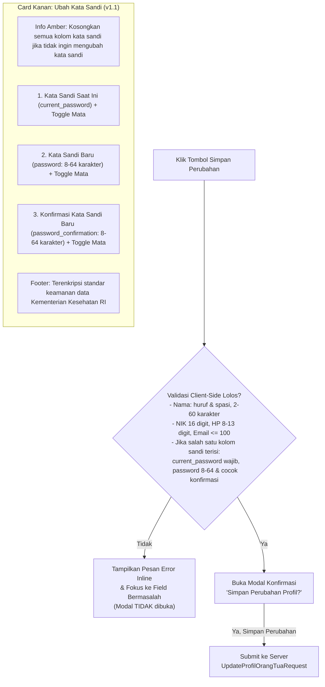

# Planning & Spesifikasi Teknis: Revisi Validasi, Batas Karakter, & Keamanan Kata Sandi Profil Orang Tua (Version 1.1)

> [!IMPORTANT]
> **Versi Dokumen:** `version 1.1` (Revisi atas [Planning Profil Orang Tua version 1.0.md](file:///d:/laragon/www/prevanta/docs/Planning%20Profil%20Orang%20Tua%20version%201.0.md))  
> Dokumen ini merupakan spesifikasi teknis resmi hasil keputusan revisi sebelum perubahan kode dieksekusi. Tidak ada file kode aplikasi yang diubah pada tahap penyusunan planning ini.

---

## 1. Latar Belakang & Ringkasan Perubahan (v1.0 → v1.1)

Hasil evaluasi antarmuka dan kode implementasi `version 1.0` menemukan beberapa celah validasi, keamanan, dan inkonsistensi antar halaman:

1. **Nama Lengkap Orang Tua belum konsisten dan masih menerima simbol/gelar:**
   - Pada v1.0, [UpdateProfilOrangTuaRequest.php](file:///d:/laragon/www/prevanta/app/Http/Requests/OrangTua/UpdateProfilOrangTuaRequest.php#L28) masih mengizinkan `.`, `,`, `'`, `-` serta panjang hingga `100` karakter tanpa batas minimal (`min`), sementara [profil.blade.php](file:///d:/laragon/www/prevanta/resources/views/orangtua/profil.blade.php#L187-L197) belum memiliki filter input / validasi client-side.
   - Data akun uji di [OrangTuaBalitaSeeder.php](file:///d:/laragon/www/prevanta/database/seeders/OrangTuaBalitaSeeder.php#L251) masih menggunakan gelar (`Siti Aminah, S.Pd.`), sehingga akan bertabrakan jika nama dikunci menjadi huruf dan spasi saja.
2. **Panjang karakter belum aman untuk driver `bcrypt` & kolom DB:**
   - Driver hashing aplikasi adalah `bcrypt` (batas efektif 72 byte), namun `password` dan `password_confirmation` belum memiliki batas maksimal (`max`) maupun atribut `maxlength`, sehingga input berlebih diam-diam terpotong oleh `bcrypt` dan rentan *payload* besar.
   - Helper text *Kata Sandi Baru* menyebutkan *"Gunakan kombinasi huruf, angka, dan simbol."*, padahal validator backend hanya memeriksa panjang minimal 8 karakter.
   - Pada endpoint registrasi ([AuthController.php](file:///d:/laragon/www/prevanta/app/Http/Controllers/AuthController.php#L98-L102) & [Api/AuthController.php](file:///d:/laragon/www/prevanta/app/Http/Controllers/Api/AuthController.php#L81-L85)), `email` belum memiliki `max:100` meskipun kolom `users.email` bertipe `VARCHAR(100)`.
3. **Pengubahan kata sandi belum memverifikasi kata sandi lama (`current_password`):**
   - Pada v1.0, siapa pun yang memiliki akses ke sesi terbuka dapat langsung mengganti kata sandi tanpa memasukkan kata sandi saat ini.
   - Kolom `password_confirmation` yang terisi sendirian ketika `password` kosong juga masih lolos tanpa peringatan.
4. **Detail UX & CSS:**
   - Pop-up modal konfirmasi *"Simpan Perubahan Profil?"* tetap terbuka walaupun input nama/kata sandi belum valid secara client-side.
   - Padding kanan `.op-input.is-password` (`42px`) terlalu mepet dengan tombol ikon mata (`40px`), dan teks nama panjang di Topbar/Hero Card belum dilindungi dari *overflow*.

---

## 2. Keputusan Terkunci (Version 1.1)

Seluruh poin berikut telah disetujui dan menjadi acuan tunggal untuk implementasi:

| No | Area | Keputusan Terkunci (v1.1) |
| :--- | :--- | :--- |
| 1 | **Format Nama Lengkap Orang Tua** | **Hanya huruf (`A–Z`, `a–z`) dan spasi saja** — tanpa angka, tanpa simbol/tanda baca, dan tanpa gelar akademik. Spasi ganda dan spasi di awal/akhir dinormalisasi otomatis. |
| 2 | **Panjang Nama Lengkap** | **Minimal `2` karakter, maksimal `60` karakter** (mengacu standar panjang nama KTP-el Dukcapil Permendagri No. 73/2022; kolom DB `users.nama` tetap `VARCHAR(100)` sebagai ruang aman). |
| 3 | **Perapian Seeder** | Nama akun uji pada [OrangTuaBalitaSeeder.php](file:///d:/laragon/www/prevanta/database/seeders/OrangTuaBalitaSeeder.php#L251) diubah dari `'Siti Aminah, S.Pd.'` menjadi `'Siti Aminah'`. Seluruh 5 akun orang tua pada seeder wajib memenuhi aturan huruf & spasi (`2–60` karakter). |
| 4 | **Panjang Email** | **Maksimal `100` karakter** (selaras dengan `users.email VARCHAR(100)`), tanpa batas `min` manual (cukup validasi format email valid). Diterapkan seragam di Profil **dan** Registrasi (Web & API). |
| 5 | **Panjang & Aturan Kata Sandi Baru** | **Minimal `8` karakter, maksimal `64` karakter** (margin aman di bawah batas 72-byte `bcrypt`). Tidak mewajibkan simbol; helper text disesuaikan menjadi jujur: *"8–64 karakter. Disarankan menggunakan kombinasi huruf dan angka."* |
| 6 | **Panjang Konfirmasi Kata Sandi** | Identik dengan Kata Sandi Baru (**`8–64` karakter**) dan saling terikat (`required_with`), sehingga tidak bisa diisi sendirian. |
| 7 | **Verifikasi Kata Sandi Lama** | Menambahkan kolom **Kata Sandi Saat Ini (`current_password`)** pada kartu *Ubah Kata Sandi*. Opsional jika user tidak mengubah kata sandi, **wajib diisi & cocok dengan kata sandi akun aktif** jika user ingin mengubah kata sandi. |
| 8 | **Sinkronisasi Registrasi & API** | Aturan nama (`2–60` huruf & spasi), email (`max:100`), dan password (`8–64`) ikut diselaraskan pada Registrasi Web ([AuthController.php](file:///d:/laragon/www/prevanta/app/Http/Controllers/AuthController.php), [registrasi.blade.php](file:///d:/laragon/www/prevanta/resources/views/auth/registrasi.blade.php)) serta API ([Api/AuthController.php](file:///d:/laragon/www/prevanta/app/Http/Controllers/Api/AuthController.php), [Api/ProfilOrangTuaController.php](file:///d:/laragon/www/prevanta/app/Http/Controllers/Api/ProfilOrangTuaController.php)). |

---

## 3. Perubahan Desain UI & Alur Interaksi



### 3.1. Perubahan pada Card Kiri (`Informasi Identitas & Kontak Orang Tua`)

- **Nama Lengkap Orang Tua (`#nama`):**
  - Atribut HTML: `minlength="2"`, `maxlength="60"`, `pattern="[A-Za-z]+( [A-Za-z]+)*"`, `required`.
  - Helper text diperbarui menjadi: `Sesuai KTP, hanya huruf dan spasi (2–60 karakter, tanpa gelar, angka, atau simbol).`
  - JS live filter (`input` event): menyaring karakter selain huruf ASCII dan spasi (`replace(/[^a-zA-Z\s]/g, '')`), mencegah spasi di awal, dan membatasi panjang maksimal `60` karakter.
- **Email (`#email`):**
  - Tetap `maxlength="100"`, `type="email"`, `required`.

### 3.2. Perubahan pada Card Kanan (`Ubah Kata Sandi`)

- **Kotak Info Amber:**
  - Teks diperbarui menjadi: `Biarkan seluruh kolom kata sandi kosong jika Anda tidak ingin mengubah kata sandi saat ini.`
- **Input Baru — Kata Sandi Saat Ini (`#current_password`, `name="current_password"`):**
  - Posisi: ditempatkan **paling atas** sebelum *Kata Sandi Baru*.
  - Ikon kiri: `fa-solid fa-key`.
  - Atribut HTML: `type="password"`, `maxlength="72"`, `placeholder="Masukkan kata sandi saat ini"`, `autocomplete="current-password"`.
  - Dilengkapi tombol *toggle show/hide* (`data-toggle-password="current_password"`) dan blok `@error('current_password')`.
  - Helper text: `Wajib diisi hanya jika Anda ingin mengganti kata sandi.`
- **Input — Kata Sandi Baru (`#password`, `name="password"`):**
  - Atribut HTML: `minlength="8"`, `maxlength="64"`, `placeholder="8–64 karakter"`, `autocomplete="new-password"`.
  - Helper text diperbarui menjadi: `8–64 karakter. Disarankan menggunakan kombinasi huruf dan angka.`
- **Input — Konfirmasi Kata Sandi Baru (`#password_confirmation`, `name="password_confirmation"`):**
  - Atribut HTML: `minlength="8"`, `maxlength="64"`, `placeholder="Ulangi kata sandi baru"`, `autocomplete="new-password"`.
  - Ditambahkan blok `@error('password_confirmation')` agar error validasi tampil tepat di bawah kolom konfirmasi.
  - Helper text: `Pastikan sama dengan kata sandi baru.`
- **Tombol Batal (`#btn-batal-profil`):**
  - Ikut mengosongkan `#current_password`, mengembalikan tipenya ke `password`, mereset ikon mata, dan menghapus status pesan error client-side.

### 3.3. Perbaikan CSS ([profil.css](file:///d:/laragon/www/prevanta/resources/css/orangtua/profil.css) & [layout.css](file:///d:/laragon/www/prevanta/resources/css/kader/layout.css))

1. **Padding Input Password ([profil.css](file:///d:/laragon/www/prevanta/resources/css/orangtua/profil.css#L439-L441)):**
   - Mengubah `.op-input.is-password` dari `padding-right: 42px;` menjadi `padding-right: 48px;` agar teks password yang panjang tidak beradu dengan tombol ikon mata.
2. **Pengaman Teks Nama Panjang (hingga 60 karakter):**
   - Pada `.op-identity-name` ([profil.css](file:///d:/laragon/www/prevanta/resources/css/orangtua/profil.css#L164-L172)): tambahkan `overflow-wrap: anywhere;` dan `flex-wrap: wrap;` (atau `span { overflow-wrap: anywhere; }`) agar nama panjang tetap rapi di dalam Hero Card tanpa menjepit tombol foto.
   - Pada `.user-name` ([layout.css](file:///d:/laragon/www/prevanta/resources/css/kader/layout.css#L388-L392)): tambahkan `max-width: 180px; overflow: hidden; text-overflow: ellipsis; white-space: nowrap;` agar Topbar tidak terdorong melebar saat nama pengguna mendekati 60 karakter.

---

## 4. Spesifikasi Validasi Backend & Keamanan

### 4.1. Normalisasi Input (`UpdateProfilOrangTuaRequest::prepareForValidation()`)

- `nama`: `preg_replace('/\s+/', ' ', trim($value))` → menghapus spasi di awal/akhir dan merapatkan spasi ganda menjadi satu spasi tunggal.
- `nik`: `trim($value)`.
- `email`: `strtolower(trim($value))`.
- `no_hp`: `trim($value)`.
- `current_password`, `password`, `password_confirmation`: **TIDAK di-`trim`** karena spasi bisa menjadi bagian sah dari kata sandi.

### 4.2. Aturan Validasi Baru (`UpdateProfilOrangTuaRequest::rules()`)

> [!NOTE]
> **Kompatibilitas Multi-Guard (Web Session & Sanctum API):**  
> Karena [UpdateProfilOrangTuaRequest.php](file:///d:/laragon/www/prevanta/app/Http/Requests/OrangTua/UpdateProfilOrangTuaRequest.php) digunakan bersama oleh rute Web (`auth`) dan rute API Mobile (`auth:sanctum`), pengecekan kecocokan `current_password` dilakukan menggunakan Closure dengan `Hash::check($value, (string) $user->password)` terhadap `$this->user()`, bukan rule string `'current_password'` polos yang secara default hanya membaca guard `web`.

| Field Input | Aturan Validasi (`rules()`) | Pesan Error Bahasa Indonesia (`messages()`) |
| :--- | :--- | :--- |
| `nama` | `['bail', 'required', 'string', 'min:2', 'max:60', 'regex:/^[a-zA-Z]+(?:\s[a-zA-Z]+)*$/']` | Wajib diisi; minimal 2 karakter; maksimal 60 karakter; hanya boleh berisi huruf dan spasi (tanpa angka atau simbol). |
| `nik` | `['bail', 'required', 'digits:16', Rule::unique('orang_tua', 'nik')->ignore($orangTua?->id)]` | Wajib diisi; tepat 16 digit angka; unik pada tabel `orang_tua`. |
| `email` | `['bail', 'required', 'string', 'email', 'max:100', Rule::unique('users', 'email')->ignore($user?->id)]` | Wajib diisi; format email valid; maksimal 100 karakter; unik pada tabel `users`. |
| `no_hp` | `['bail', 'required', 'digits_between:8,13']` | Wajib diisi; 8 sampai 13 digit angka. |
| `foto_profil` | `['bail', 'nullable', File::image()->types(['jpg', 'jpeg', 'png', 'webp'])->max('2mb')]` | Opsional; gambar JPG/JPEG/PNG/WEBP maksimal 2 MB. |
| `hapus_foto` | `['nullable', 'boolean']` | Status penghapusan foto tidak valid. |
| `current_password` | `['bail', 'required_with:password,password_confirmation', 'nullable', 'string', 'max:72', Closure Hash::check($value, $user->password)]` | Wajib diisi jika ingin mengubah kata sandi; jika salah tampilkan: *"Kata sandi saat ini tidak sesuai."* |
| `password` | `['bail', 'required_with:current_password,password_confirmation', 'nullable', 'string', 'min:8', 'max:64', 'different:current_password', 'confirmed']` | Wajib diisi jika mengubah kata sandi; minimal 8 karakter; maksimal 64 karakter; harus berbeda dari kata sandi saat ini; wajib cocok dengan konfirmasi. |
| `password_confirmation` | `['bail', 'required_with:current_password,password', 'nullable', 'string', 'max:64']` | Wajib diisi jika mengubah kata sandi; maksimal 64 karakter. |

### 4.3. Matriks Skenario Ubah Kata Sandi

| `current_password` | `password` | `password_confirmation` | Hasil yang Diharapkan |
| :--- | :--- | :--- | :--- |
| Kosong | Kosong | Kosong | **Lolos** — profil diperbarui, kata sandi lama tidak berubah. |
| Kosong | Terisi (`SandiBaru123`) | Terisi (`SandiBaru123`) | **Gagal (422)** — `current_password` wajib diisi. |
| Salah (`Salah123`) | Terisi (`SandiBaru123`) | Terisi (`SandiBaru123`) | **Gagal (422)** — *"Kata sandi saat ini tidak sesuai."* |
| Benar | Kosong | Kosong | **Gagal (422)** — `password` & `password_confirmation` wajib diisi. |
| Kosong | Kosong | Terisi (`SandiBaru123`) | **Gagal (422)** — `current_password` & `password` wajib diisi (menutup celah v1.0). |
| Benar | Sama dengan sandi lama | Sama dengan sandi lama | **Gagal (422)** — *"Kata sandi baru harus berbeda dengan kata sandi saat ini."* |
| Benar | `< 8` atau `> 64` karakter | Sama | **Gagal (422)** — minimal 8 / maksimal 64 karakter. |
| Benar | Valid (`8–64` karakter) | Tidak cocok | **Gagal (422)** — *"Konfirmasi kata sandi baru tidak cocok."* |
| Benar | Valid (`8–64` karakter) | Cocok & beda dari lama | **Lolos (200/302)** — kata sandi di-hash dengan `Hash::make()` dan disimpan. |

### 4.4. Sinkronisasi Validasi Registrasi (Web & API)

Agar tidak terjadi inkonsistensi antara akun baru (Registrasi) dan pembaruan akun (Profil), penyesuaian berikut ikut diterapkan pada [AuthController.php](file:///d:/laragon/www/prevanta/app/Http/Controllers/AuthController.php#L85-L124), [Api/AuthController.php](file:///d:/laragon/www/prevanta/app/Http/Controllers/Api/AuthController.php#L70-L103), dan [registrasi.blade.php](file:///d:/laragon/www/prevanta/resources/views/auth/registrasi.blade.php):

- `name`: `['required', 'string', 'min:2', 'max:60', 'regex:/^[a-zA-Z]+(?:\s[a-zA-Z]+)*$/']` + normalisasi spasi ganda sebelum validasi; HTML `minlength="2" maxlength="60"`.
- `email`: tambahkan `'max:100'` di backend dan `maxlength="100"` di HTML.
- `password`: `['required', 'string', 'min:8', 'max:64', 'confirmed']`; HTML `minlength="8" maxlength="64"`.
- `password_confirmation`: HTML `minlength="8" maxlength="64"`.

---

## 5. Dampak Arsitektur Database & Integrasi API Mobile

### 5.1. Database & Seeder
- **Tidak perlu migrasi baru:** Struktur tabel `users` (`nama VARCHAR(100)`, `email VARCHAR(100) UNIQUE`, `password VARCHAR(255)`) dan `orang_tua` sudah mencukupi.
- **Perapian Seeder ([OrangTuaBalitaSeeder.php](file:///d:/laragon/www/prevanta/database/seeders/OrangTuaBalitaSeeder.php#L251)):**
  - Akun 1 (`orangtua@gmail.com`): `'Siti Aminah, S.Pd.'` → **`'Siti Aminah'`**.
  - Akun 2–5 (`Budi Santoso`, `Ratna Dewi Sari`, `Hendra Wijaya`, `Maya Lestari`): sudah sesuai aturan huruf & spasi (`2–60` karakter).
- **Catatan data lokal yang sudah ada:** Setelah seeder diperbarui, jalankan ulang `php artisan db:seed --class=OrangTuaBalitaSeeder` agar record `orangtua@gmail.com` di DB lokal ikut berubah menjadi `Siti Aminah` (atau bersihkan nama akun uji yang masih mengandung gelar/angka di DB lokal).

### 5.2. Dampak Kontrak API Mobile (`/api/ortu/profil` & `/api/orangtua/profil`)
> [!WARNING]
> **Perubahan Kontrak API (Breaking untuk fitur Ganti Kata Sandi di Flutter):**  
> Saat aplikasi mobile mengirim permintaan `POST /api/ortu/profil` atau `POST /api/orangtua/profil` yang menyertakan `password`, request **wajib** menyertakan field baru `current_password`. Permintaan update profil **tanpa** mengubah kata sandi (mengosongkan ketiga field kata sandi) tetap kompatibel 100%.

---

## 6. Daftar File yang Akan Diubah

| No | Path File | Deskripsi Perubahan |
| :--- | :--- | :--- |
| 1 | [database/seeders/OrangTuaBalitaSeeder.php](file:///d:/laragon/www/prevanta/database/seeders/OrangTuaBalitaSeeder.php) | Merapikan nama akun default dari `'Siti Aminah, S.Pd.'` menjadi `'Siti Aminah'`. |
| 2 | [app/Http/Requests/OrangTua/UpdateProfilOrangTuaRequest.php](file:///d:/laragon/www/prevanta/app/Http/Requests/OrangTua/UpdateProfilOrangTuaRequest.php) | Memperbarui normalisasi `nama`, aturan `nama` (`min:2`, `max:60`, huruf & spasi), `password` (`min:8`, `max:64`, `different:current_password`), `password_confirmation` (`required_with`, `max:64`), dan menambahkan validasi `current_password` multi-guard via `Hash::check()`. |
| 3 | [resources/views/orangtua/profil.blade.php](file:///d:/laragon/www/prevanta/resources/views/orangtua/profil.blade.php) | Menambah input `current_password` + toggle mata, menambah `minlength`/`maxlength` (`nama` 2–60, `password` & konfirmasi 8–64), memperbarui helper text, menambah `@error('password_confirmation')`, menyaring input nama via JS, dan menjalankan validasi client-side sebelum membuka modal konfirmasi. |
| 4 | [resources/css/orangtua/profil.css](file:///d:/laragon/www/prevanta/resources/css/orangtua/profil.css) | Menaikkan `padding-right` pada `.op-input.is-password` ke `48px` dan menambahkan pengaman *wrapping* nama panjang pada `.op-identity-name`. |
| 5 | [resources/css/kader/layout.css](file:///d:/laragon/www/prevanta/resources/css/kader/layout.css) | Menambahkan `max-width` dan `text-overflow: ellipsis` pada `.user-name` di Topbar agar nama hingga 60 karakter tidak merusak layout. |
| 6 | [app/Http/Controllers/AuthController.php](file:///d:/laragon/www/prevanta/app/Http/Controllers/AuthController.php) | Menyamakan validasi registrasi web: `name` (`min:2`, `max:60`, huruf & spasi), `email` (`max:100`), `password` (`min:8`, `max:64`). |
| 7 | [app/Http/Controllers/Api/AuthController.php](file:///d:/laragon/www/prevanta/app/Http/Controllers/Api/AuthController.php) | Menyamakan validasi registrasi API: `name` (`min:2`, `max:60`, huruf & spasi), `email` (`max:100`), `password` (`min:8`, `max:64`). |
| 8 | [resources/views/auth/registrasi.blade.php](file:///d:/laragon/www/prevanta/resources/views/auth/registrasi.blade.php) | Menambahkan `minlength`/`maxlength` (`name` 2–60, `email` 100, `password` & konfirmasi 8–64) serta menyelaraskan validasi JS. |
| 9 | [tests/Feature/OrangTua/ProfilOrangTuaTest.php](file:///d:/laragon/www/prevanta/tests/Feature/OrangTua/ProfilOrangTuaTest.php) | Memperbarui data uji nama tanpa gelar dan menambahkan test case untuk aturan nama `2–60` huruf & spasi, password `8–64`, `current_password` (benar/salah/kosong/sama dengan baru), dan `password_confirmation` sendirian. |
| 10 | [tests/Feature/Api/ProfilOrangTuaApiTest.php](file:///d:/laragon/www/prevanta/tests/Feature/Api/ProfilOrangTuaApiTest.php) | Memperbarui data uji dan menambahkan cakupan test API Sanctum untuk `current_password`, batas panjang nama/password, serta validasi huruf & spasi. |
| 11 | [tests/Feature/OrangTuaBalitaSeederTest.php](file:///d:/laragon/www/prevanta/tests/Feature/OrangTuaBalitaSeederTest.php) | Menambahkan asersi bahwa seluruh akun orang tua hasil seeder mematuhi format nama huruf & spasi (`2–60` karakter). |

---

## 7. Task Board Eksekusi (Step-by-Step)

### Fase 1: Seeder & Validasi Backend
- [x] **Step 1.1:** Rapikan nama akun default pada [OrangTuaBalitaSeeder.php](file:///d:/laragon/www/prevanta/database/seeders/OrangTuaBalitaSeeder.php#L251) menjadi `'Siti Aminah'`.
- [x] **Step 1.2:** Perbarui [UpdateProfilOrangTuaRequest.php](file:///d:/laragon/www/prevanta/app/Http/Requests/OrangTua/UpdateProfilOrangTuaRequest.php) untuk aturan `nama` (`2–60`, huruf & spasi + normalisasi spasi ganda), `password` (`8–64`, `different:current_password`), `password_confirmation`, dan verifikasi `current_password` multi-guard.
- [x] **Step 1.3:** Selaraskan aturan validasi registrasi pada [AuthController.php](file:///d:/laragon/www/prevanta/app/Http/Controllers/AuthController.php) dan [Api/AuthController.php](file:///d:/laragon/www/prevanta/app/Http/Controllers/Api/AuthController.php).

### Fase 2: Antarmuka Blade & CSS
- [x] **Step 2.1:** Perbarui [profil.blade.php](file:///d:/laragon/www/prevanta/resources/views/orangtua/profil.blade.php) (input `current_password`, `minlength`/`maxlength`, helper text, sanitasi nama, validasi client-side sebelum buka modal konfirmasi, serta reset tombol *Batal*).
- [x] **Step 2.2:** Perbarui [profil.css](file:///d:/laragon/www/prevanta/resources/css/orangtua/profil.css) (`padding-right: 48px` & proteksi *overflow* Hero Card) serta [layout.css](file:///d:/laragon/www/prevanta/resources/css/kader/layout.css) (*ellipsis* `.user-name` di Topbar), lalu jalankan `npm run build` jika aset Vite perlu di-compile ulang.
- [x] **Step 2.3:** Selaraskan atribut panjang dan validasi JS pada [registrasi.blade.php](file:///d:/laragon/www/prevanta/resources/views/auth/registrasi.blade.php).

### Fase 3: Pengujian & Code Formatting
- [x] **Step 3.1:** Perbarui & tambah skenario test di [ProfilOrangTuaTest.php](file:///d:/laragon/www/prevanta/tests/Feature/OrangTua/ProfilOrangTuaTest.php), [ProfilOrangTuaApiTest.php](file:///d:/laragon/www/prevanta/tests/Feature/Api/ProfilOrangTuaApiTest.php), dan [OrangTuaBalitaSeederTest.php](file:///d:/laragon/www/prevanta/tests/Feature/OrangTuaBalitaSeederTest.php).
- [x] **Step 3.2:** Jalankan pengujian:
  ```bash
  php artisan test --compact tests/Feature/OrangTua/ProfilOrangTuaTest.php tests/Feature/Api/ProfilOrangTuaApiTest.php tests/Feature/OrangTuaBalitaSeederTest.php
  ```
- [x] **Step 3.3:** Jalankan Laravel Pint (`vendor/bin/pint --dirty --format agent`) dan jalankan ulang seeder pada DB lokal (`php artisan db:seed --class=OrangTuaBalitaSeeder` sesuai kebutuhan DB lokal).
